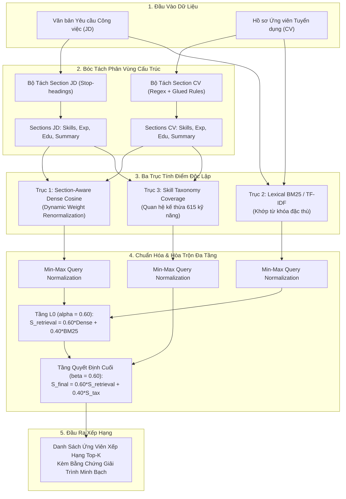

# SO KHỚP HỒ SƠ ỨNG VIÊN VÀ MÔ TẢ CÔNG VIỆC CÓ NHẬN BIẾT PHÂN VÙNG CẤU TRÚC KẾT HỢP ONTOLOGY KỸ NĂNG VÀ TRUY XUẤT ĐA TẦNG

**Tác giả**: Nhóm Nghiên Cứu Hệ Thống Tuyển Dụng Thông Minh  
**Đơn vị**: Khoa Công Nghệ Thông Tin / Khoa Khoa Học Máy Tính  
**Dự án**: Nghiên cứu & Phát triển Hệ thống Tuyển dụng Frevia (`section-aware-cv-job-matching`)  
**Ngày phát hành**: Tháng 11 Năm 2026  
**Trạng thái**: Báo cáo Nghiên cứu & Chuyên khảo Kỹ thuật Toàn văn (Monograph / Full Research Paper)

---

## TÓM TẮT (ABSTRACT)

Các hệ thống so khớp hồ sơ ứng viên (Curriculum Vitae - CV) và bản mô tả công việc (Job Description - JD) dựa trên học sâu hiện nay chủ yếu áp dụng phương pháp biểu diễn toàn văn thành một vector duy nhất (**Single-Vector Embedding**). Phương pháp này bộc lộ hai hạn chế cốt tử trong bài toán tuyển dụng thực tế: *(1) Hiện tượng cắt cụt token (Truncation)* khi độ dài CV thực tế (~966 từ) vượt quá cửa sổ ngữ cảnh của các mô hình ngôn ngữ phổ biến (ví dụ: `all-MiniLM-L6-v2` chỉ hỗ trợ tối đa 256 tokens), dẫn đến việc đánh mất hoàn toàn các khối thông tin quan trọng ở nửa sau hồ sơ như kỹ năng chuyên sâu và học vấn; và *(2) Hiện tượng pha loãng ngữ nghĩa (Semantic Dilution)*, khi các câu chữ giới thiệu chung làm mờ nhạt các tiêu chí kỹ thuật bắt buộc.

Bài báo này đề xuất một kiến trúc hệ thống truy xuất và xếp hạng ứng viên minh bạch gồm ba thành phần phối hợp:
1. **Bộ tách phân vùng cấu trúc (Section-Aware Parser)**: Phân rã văn bản tự do thành 4 khối chức năng cốt lõi (*Skills*, *Experience*, *Education*, *Summary*) bằng tập luật xử lý tiêu đề dính chữ đặc thù của dữ liệu web, đạt độ chính xác 93.55% và đưa tỷ lệ lỗi phân vùng (fallback) về 0.00%.
2. **Biểu diễn ngữ nghĩa đa vector có trọng số động (Section-Aware Dense Vector)**: Mã hóa độc lập từng phân vùng và tính điểm tương đồng Cosine chéo có bù trừ khuyết thiếu, giải quyết triệt để vấn đề cắt cụt token mà không cần nâng cấp lên các mô hình cồng kềnh.
3. **Mô hình lai kết hợp Ontology kỹ năng (Calibrated Hybrid + Taxonomy)**: Tích hợp bộ từ điển 615 khái niệm kỹ năng chuẩn hóa với cơ chế tính độ bao phủ bất đối xứng (Asymmetric Coverage) và đối sánh quan hệ chuyên môn (Specialized, Sibling), kết hợp truy xuất từ vựng BM25 qua tầng chuẩn hóa Min-Max tuyến tính theo từng truy vấn.

Thực nghiệm toàn diện được tiến hành trên hai tập dữ liệu công khai lớn: `cnamuangtoun/resume-job-description-fit` (với 1.759 cặp kiểm thử và 1.829 cặp huấn luyện sạch) và `med2425/resume-job-fit-merged-v1` (với 8.575 cặp miền CNTT được thẩm định bởi LLM Recruiter Qwen2.5-32B). Kết quả kiểm định thống kê cặp với khoảng tin cậy Bootstrap 95% và hiệu chỉnh đa so sánh Holm-Bonferroni chỉ ra rằng: Section-Aware đạt mức tương đương thống kê về độ chính xác top đầu so với các mô hình ngữ cảnh dài đắt đỏ, nhưng cho phép triển khai với chi phí tính toán cực thấp ($T_{\text{rank}} = 0.12$\,ms trên CPU thông thường). Đặc biệt, trong môi trường tuyển dụng có mật độ ứng viên lớn (~209 ứng viên/vị trí), mô hình Calibrated Hybrid tạo ra bước nhảy vọt $+0.085$ nDCG@10 so với Single-Vector, đồng thời cung cấp khả năng giải trình bằng chứng minh bạch phục vụ trực tiếp cho nhà tuyển dụng.

---

## 1. ĐẶT VẤN ĐỀ & ĐỘNG LỰC NGHIÊN CỨU (INTRODUCTION)

### 1.1. Bối cảnh bài toán so khớp CV – JD trong kỷ nguyên số
Trong quy trình tuyển dụng nhân sự hiện đại, việc sàng lọc hồ sơ ứng viên (CV Screening) đóng vai trò then chốt nhưng lại tiêu tốn phần lớn thời gian của chuyên viên nhân sự (HR). Một vị trí tuyển dụng kỹ sư phần mềm tại các công ty công nghệ có thể thu hút hàng trăm đến hàng nghìn CV. Để tự động hóa giai đoạn này, các hệ thống Thu hồi Thông tin (Information Retrieval - IR) và Xếp hạng Ứng viên (Candidate Ranking) được phát triển nhằm tính toán mức độ phù hợp giữa một truy vấn tuyển dụng (JD $q$) và danh sách hồ sơ ứng viên (tập ứng viên $\mathcal{D}_q = \{d_1, d_2, \dots, d_N\}$).

### 1.2. Hạn chế cốt tử của phương pháp Single-Vector truyền thống

Hầu hết các hệ thống hiện nay sử dụng mô hình Bi-Encoder (như Sentence-BERT / all-MiniLM-L6-v2) để nén toàn bộ văn bản của CV và JD thành một vector duy nhất trong không gian vector đa chiều (ví dụ 384 chiều). Cách tiếp cận này đối mặt với 3 rào cản nghiêm trọng:

```
[ TOÀN VĂN CV GỐC DÀI ~966 TỪ ]
┌─────────────────────────────────────────────────────────────┬────────────────────────────────┐
│ PHẦN 1: Tóm tắt & Kinh nghiệm làm việc (~700 tokens)        │ PHẦN 2: Kỹ năng & Học vấn      │
│ (Được mô hình đọc và nén vào vector)                         │ (BỊ CẮT BỎ HOÀN TOÀN TỪ TOKEN 256)│
└─────────────────────────────────────────────────────────────┴────────────────────────────────┘
                                                               ▲
                                             Ngưỡng cắt cụt của all-MiniLM (256 tokens)
```

1. **Vấn đề Cắt cụt Token (Token Truncation)**:
   * Mô hình `all-MiniLM-L6-v2` có tham số độ dài tối đa `max_seq_length = 256` tokens.
   * Khảo sát thực tế trên kho ngữ liệu kiểm thử (477 CVs) cho thấy CV trung bình dài 701 tokens cho riêng phần kinh nghiệm làm việc, và toàn văn bản dài gần 1.000 tokens.
   * Hậu quả: Khi đưa toàn bộ văn bản vào mô hình, **hơn 95% CV bị cắt bỏ nửa sau**. Phần bị cắt bỏ thường lại là danh sách kỹ năng kỹ thuật cốt lõi (Technical Skills), chứng chỉ, và bằng cấp học vấn (Education).
2. **Vấn đề Pha loãng Ngữ nghĩa (Semantic Dilution)**:
   * Khi ép toàn bộ kinh nghiệm, sở thích, thông tin liên lạc và kỹ năng vào một vector 384 chiều, các từ ngữ hoa mỹ hoặc câu chữ mô tả chung chung sẽ "pha loãng" tín hiệu kỹ thuật. Một ứng viên ghi nhiều câu chuyện dự án nhưng thiếu kỹ năng bắt buộc (ví dụ: `Docker`, `Kubernetes`) vẫn có thể nhận điểm tương đồng ngữ nghĩa cao do từ vựng chung chung trùng khớp.
3. **Thiếu khả năng giải trình (Lack of Explainability)**:
   * Điểm số Cosine của Single-Vector là một "hộp đen" (Black-box). Nhà tuyển dụng không thể biết điểm số $0.82$ là do ứng viên giỏi kỹ năng, hay do có nhiều năm kinh nghiệm, hay do học trường danh tiếng.

### 1.3. Đóng góp khoa học của nghiên cứu
Để khắc phục triệt để các vấn đề trên, nghiên cứu này mang lại 4 đóng góp chính:
1. **Kiến trúc Section-Aware có khả năng tự chuẩn hóa trọng số động**: Tách CV thành 4 vector phân vùng chuyên biệt, loại bỏ hoàn toàn hiện tượng cắt cụt token và cho phép gán trọng số linh hoạt theo nghiệp vụ nhân sự.
2. **Ontology kỹ năng chuẩn hóa 3 tầng kết hợp Asymmetric Coverage**: Xây dựng ontology 615 khái niệm kỹ năng kỹ thuật, phân biệt kỹ năng bắt buộc (*Must-have*) và tùy chọn (*Nice-to-have*), bù đắp điểm mù của các mô hình ngôn ngữ đối với từ viết tắt và quan hệ kế thừa công nghệ.
3. **Quy trình chuẩn hóa điểm số đa tầng (Calibration & Hybrid Fusion)**: Kết hợp Dense Semantic, Sparse BM25 và Taxonomy Coverage qua tầng chuẩn hóa Min-Max tuyến tính theo từng truy vấn, khắc phục sự chênh lệch phân phối điểm giữa các thuật toán.
4. **Kiểm toán phương pháp luận nghiêm ngặt và đối chứng đa dataset**: Công bố kết quả thực nghiệm trên 1.759 cặp kiểm thử chính thức, 1.829 cặp huấn luyện sạch (Held-out clean train queries), và 8.575 cặp kiểm chứng ngoại vi có nhãn LLM Recruiter, kèm toàn bộ kiểm định thống kê cặp (Paired Bootstrap 95% CI và hiệu chỉnh Holm-Bonferroni).

---

## 2. PHƯƠNG PHÁP LUẬN & MÔ TẢ CHI TIẾT CÁC CÔNG THỨC TOÁN HỌC

Kiến trúc tổng thể của hệ thống được mô tả qua sơ đồ dòng dữ liệu dưới đây:



---

### 2.1. Phân Vùng Cấu Trúc Tài Liệu (Section Parsing) & Tỷ Lệ Fallback

#### a) Định nghĩa không gian phân vùng
Mỗi tài liệu CV hoặc JD sau khi qua bộ tách được chuẩn hóa về một tập hợp các phân vùng chức năng $\mathcal{S}$:
$$\mathcal{S} = \{\text{skills}, \text{experience}, \text{education}, \text{summary}\}$$

* **Skills**: Liệt kê các công nghệ, ngôn ngữ lập trình, công cụ, khung làm việc (Frameworks).
* **Experience**: Lịch sử công tác, dự án đã tham gia, nhiệm vụ đảm trách và thành tựu.
* **Education**: Trình độ học vấn, trường đào tạo, chuyên ngành, chứng chỉ nghề nghiệp.
* **Summary**: Tóm tắt năng lực cá nhân, mục tiêu nghề nghiệp (Career objective).

#### b) Xử lý hiện tượng dính chữ tiêu đề (Glued Line-Start Headings)
Dữ liệu thu thập tự động từ HTML web thường làm mất các thẻ ngắt dòng `<br>` hoặc `<div>`, khiến tiêu đề bị dính liền vào từ đầu tiên của đoạn văn, ví dụ:
* `SummaryHighly motivated software engineer...`
* `Experience08/2014 to Current Senior Developer...`
* `EducationMaster of Science in Computer Science...`

Bộ tách phân vùng sử dụng cơ chế biểu thức chính quy với kỹ thuật **Positive Lookahead (soi trước không tiêu thụ ký tự)**. Luật chỉ kích hoạt khi ngay sau từ khóa heading là một ký tự viết hoa, chữ số, hoặc dấu gạch ngang:
$$R_{\text{glued}} = \verb!^(?i:summary|profile|skills|experience|education)(?=[A-Z0-9\-])!$$

Kỹ thuật này đảm bảo nhận diện chính xác các heading bị dính chữ mà không bao giờ nhận nhầm các từ ngữ bình thường trong văn bản (ví dụ từ `skilled` hay `experienced` viết thường sẽ không bị cắt).

---

### 2.2. Trục 1: Điểm Tương Đồng Ngữ Nghĩa Phân Vùng (Section-Aware Dense Vector)

#### a) Mã hóa vector từng phân vùng
Với mỗi phân vùng chức năng $s \in \mathcal{S}$, nếu tài liệu $d$ (CV) và truy vấn $q$ (JD) có nội dung tại phân vùng này, văn bản của phân vùng được đưa qua mô hình ngôn ngữ mã hóa Bi-Encoder để tạo vector nhúng (Embedding Vector):
$$\mathbf{u}_s = \text{Encoder}(\text{text}_s(q)) \in \mathbb{R}^D, \quad \mathbf{v}_s = \text{Encoder}(\text{text}_s(d)) \in \mathbb{R}^D$$
*(Trong nghiên cứu này, sử dụng `all-MiniLM-L6-v2` với số chiều $D = 384$)*.

Độ tương đồng Cosine chuẩn hóa giữa hai vector cùng phân vùng được tính theo công thức:
$$\text{sim}_s(q, d) = \cos(\mathbf{u}_s, \mathbf{v}_s) = \frac{\mathbf{u}_s \cdot \mathbf{v}_s}{\|\mathbf{u}_s\|_2 \|\mathbf{v}_s\|_2} = \frac{\sum_{i=1}^{D} u_{s,i} \cdot v_{s,i}}{\sqrt{\sum_{i=1}^{D} u_{s,i}^2} \cdot \sqrt{\sum_{i=1}^{D} v_{s,i}^2}}$$

Vì các vector xuất ra từ mô hình đã được chuẩn hóa độ dài Euclidean bằng 1 ($\|\mathbf{u}_s\|_2 = \|\mathbf{v}_s\|_2 = 1$), công thức rút gọn thành tích vô hướng:
$$\text{sim}_s(q, d) = \mathbf{u}_s \cdot \mathbf{v}_s = \sum_{i=1}^{D} u_{s,i} \cdot v_{s,i}$$

#### b) Cơ chế Fallback mềm (Soft Cross-Comparison) khi JD bị khuyết Section
Trong thực tế, nhiều bản mô tả công việc (JD) không chia đủ các mục (ví dụ chỉ có mục Yêu cầu chung mà không có mục Tóm tắt hay Học vấn). Khi JD bị thiếu section $s$, hệ thống không bỏ qua mà áp dụng cơ chế so sánh mềm: so khớp vector phân vùng $\mathbf{v}_s$ của CV với **vector toàn văn $\mathbf{u}_{\text{full}}$ của JD**, đồng thời phạt 50% trọng số của phân vùng đó:
$$\text{sim}_s(q, d) = \mathbf{u}_{\text{full}} \cdot \mathbf{v}_s, \quad \text{với trọng số hiệu dụng } w'_s = 0.5 \cdot w_s$$

#### c) Cơ chế Tái Chuẩn Hóa Trọng Số Động (Dynamic Weight Renormalization)
Khi một CV bị thiếu một hoặc nhiều section (ví dụ CV của sinh viên mới tốt nghiệp chưa có mục kinh nghiệm làm việc), nếu vẫn giữ nguyên mẫu số bằng 1.0 thì tổng điểm của ứng viên sẽ bị sụt giảm bất công. Hệ thống áp dụng công thức tái chuẩn hóa động:
$$S_{\text{dense}}(q, d) = \frac{\sum_{s \in \mathcal{S}_{\text{present}}} w'_s \cdot \text{sim}_s(q, d)}{\sum_{s \in \mathcal{S}_{\text{present}}} w'_s}$$
*Trong đó $\mathcal{S}_{\text{present}}$ là tập hợp các section thực sự có mặt trong hồ sơ ứng viên.*

> **Ví dụ minh họa tính toán**:
> Giả sử một CV chỉ có 2 mục: **Skills** ($\text{sim}_{\text{skills}} = 0.80$) và **Experience** ($\text{sim}_{\text{exp}} = 0.70$), bị khuyết Education và Summary.
> - Tổng tử số: $0.40 \times 0.80 + 0.35 \times 0.70 = 0.32 + 0.245 = 0.565$.
> - Tổng mẫu số chuẩn hóa: $0.40 + 0.35 = 0.75$.
> - Điểm Dense cuối cùng: $S_{\text{dense}} = \frac{0.565}{0.75} \approx 0.7533$.
> *(Điểm số được bù trừ hoàn hảo theo năng lực thực tế của các phần hiện diện, không bị kéo tụt bởi các phần khuyết thiếu).*

#### d) Giải thích chi tiết ý nghĩa từng hằng số trọng số Section ($w_s$)
Bộ trọng số mặc định được thiết lập dựa trên khảo sát thực tế quy trình sàng lọc hồ sơ của các chuyên viên nhân sự trong ngành công nghệ thông tin:
* **$w_{\text{skills}} = 0.40$ (40% - Trọng số cao nhất)**:
  * *Lý do*: Trong tuyển dụng kỹ thuật, kỹ năng chuyên môn (ngôn ngữ, công nghệ, công cụ) là điều kiện cần tiên quyết. Một ứng viên dù có 10 năm kinh nghiệm nhưng sai lệch hoàn toàn công nghệ (ví dụ tuyển Java nhưng ứng viên chỉ làm PHP) thì hồ sơ sẽ bị loại ngay từ vòng duyệt đầu tiên.
* **$w_{\text{experience}} = 0.35$ (35% - Trọng số cao thứ hai)**:
  * *Lý do*: Kinh nghiệm dự án là minh chứng cho việc ứng viên đã áp dụng các kỹ năng vào thực tế giải quyết bài toán nghiệp vụ như thế nào. Trọng số này bổ trợ trực tiếp cho kỹ năng.
* **$w_{\text{education}} = 0.15$ (15% - Trọng số nền tảng)**:
  * *Lý do*: Trình độ đại học, cao đẳng hoặc chứng chỉ chuyên ngành là yếu tố bảo chứng cho nền tảng tư duy, nhưng trong ngành CNTT, bằng cấp không mang tính quyết định tuyệt đối như kỹ năng thực chiến.
* **$w_{\text{summary}} = 0.10$ (10% - Trọng số định hướng)**:
  * *Lý do*: Phần giới thiệu bản thân thể hiện thái độ, mục tiêu nghề nghiệp và sự phù hợp văn hóa, đóng vai trò gia vị cộng thêm cho hồ sơ.
* **Tổng các trọng số**: $0.40 + 0.35 + 0.15 + 0.10 = 1.00$.

---

### 2.3. Trục 2: Điểm So Khớp Từ Vựng Chuẩn Xác (Lexical BM25 / TF-IDF)

Mặc dù mô hình ngữ nghĩa (Dense Vector) nắm bắt rất tốt ngữ cảnh tương đồng (ví dụ hiểu `frontend` liên quan đến `React`), nó lại thường gặp điểm mù với các thuật ngữ kỹ thuật viết hoa, phiên bản công nghệ (ví dụ `Python 3.12` vs `Python 2.7`), hoặc các mã định danh viết tắt chuyên biệt. Do đó, hệ thống tích hợp bộ lọc từ vựng kinh điển **BM25 / TF-IDF**.

#### a) Công thức tính trọng số từ (Term Weighting)
Sử dụng hàm tần suất từ có hiệu chỉnh phi tuyến dưới dạng logarit (**Sublinear Term Frequency**) để tránh hiện tượng một từ lặp lại quá nhiều lần trong CV gây nhiễu điểm số:
$$\text{TF}(t, d) = \begin{cases} 1 + \ln(f_{t, d}) & \text{nếu } f_{t, d} > 0 \\ 0 & \text{nếu } f_{t, d} = 0 \end{cases}$$
*Trong đó $f_{t, d}$ là số lần từ $t$ xuất hiện trong văn bản tài liệu $d$.*

Nghịch đảo tần suất văn bản (**Inverse Document Frequency - IDF**) đo lường độ hiếm và độ đặc trưng của từ $t$ trên toàn bộ kho ngữ liệu gồm $N$ tài liệu:
$$\text{IDF}(t) = \ln\left(\frac{1 + N}{1 + \text{DF}(t)}\right) + 1$$
*Trong đó $\text{DF}(t)$ là số lượng tài liệu trong toàn bộ corpus có chứa từ $t$. Từ càng phổ biến (như "job", "company") sẽ có IDF rất thấp; từ càng hiếm và đặc trưng (như "Kubernetes", "PyTorch") sẽ có IDF rất cao.*

#### b) Điểm tương đồng từ vựng tổng hợp
$$S_{\text{bm25}}(q, d) = \sum_{t \in q \cap d} \text{TF}(t, d) \cdot \text{IDF}(t)$$
*Điểm số được tính bằng tích vô hướng giữa vector trọng số TF-IDF của JD và CV.*

---

### 2.4. Trục 3: Khớp Ontology Kỹ Năng Kế Thừa (Skill Taxonomy Coverage)

Hệ thống sử dụng bộ từ điển chuẩn hóa **615 kỹ năng kỹ thuật** (`skills_taxonomy.json`), được cấu trúc theo đồ thị có hướng mô tả các mối quan hệ ngữ nghĩa giữa các công nghệ.

```
       [ Deep Learning ]  (Khái niệm rộng / Cha)
              ▲
              │ w_rel = 0.8 (specialized_in)
              │
         [ PyTorch ]      (Kỹ năng ứng viên có)
```

#### a) Phân loại kỹ năng bắt buộc và tùy chọn trong JD
Khi phân tích JD $q$, hệ thống bóc tách hai tập hợp kỹ năng:
* **$M_q$ (Must-have Skills)**: Các kỹ năng nằm trong câu chứa từ khóa bắt buộc (`required`, `must have`, `essential`, `minimum qualifications`).
* **$N_q$ (Nice-to-have Skills)**: Các kỹ năng nằm trong câu chứa từ khóa ưu tiên (`preferred`, `plus`, `nice to have`, `bonus`).
* Toàn bộ kỹ năng yêu cầu: $K_q = M_q \cup N_q$.

Tập hợp các kỹ năng trích xuất được từ CV của ứng viên ký hiệu là $C_d$.

#### b) Trọng số quan hệ ngữ nghĩa ($w_{\text{rel}}$)
Khi ứng viên không có chính xác kỹ năng $j \in K_q$ mà JD yêu cầu, hệ thống tra cứu đồ thị Ontology để tìm kỹ năng tương đương hoặc chuyên môn hóa mà ứng viên sở hữu:
$$w_{\text{rel}}(c, j) = \begin{cases} 
1.0 & \text{nếu } c = j \text{ (Khớp chính xác hoàn toàn)} \\
0.8 & \text{nếu } c \text{ là chuyên môn hóa sâu của } j \text{ (Quan hệ 'specialized_in')} \\
0.5 & \text{nếu } c \text{ và } j \text{ là công nghệ cùng họ tương đương (Quan hệ 'related_to')} \\
0.0 & \text{nếu không có quan hệ trong Ontology}
\end{cases}$$

> **Giải thích ý nghĩa từng hằng số quan hệ**:
> * **$w_{\text{rel}} = 1.0$ (Khớp tuyệt đối)**: Ứng viên ghi đúng kỹ năng (hoặc từ đồng nghĩa/alias chuẩn, ví dụ ghi `k8s` được chuẩn hóa thành `kubernetes`).
> * **$w_{\text{rel}} = 0.8$ (80% điểm chuyên môn sâu)**: JD yêu cầu chung chung là `Deep Learning`, nhưng ứng viên ghi rõ là chuyên gia `PyTorch`. Ứng viên nắm công cụ cụ thể đương nhiên đáp ứng tốt yêu cầu chung của bài toán $\rightarrow$ cho 80% điểm.
> * **$w_{\text{rel}} = 0.5$ (50% điểm công nghệ tương đương)**: JD yêu cầu cơ sở dữ liệu `PostgreSQL`, ứng viên thành thạo `MySQL`. Mặc dù hai hệ quản trị khác nhau, nhưng nền tảng kiến thức SQL, đánh chỉ mục và tối ưu hóa truy vấn có thể chuyển giao nhanh chóng trong thực tế $\rightarrow$ công nhận 50% điểm tương đương.

#### c) Công thức Độ Bao Phủ Bất Đối Xứng (Asymmetric Coverage) & Phân Tách Must / Nice
Nhiều nghiên cứu trước đây dùng chỉ số đối xứng **Jaccard Similarity**:
$$J(A, B) = \frac{|A \cap B|}{|A \cup B|}$$
**Hạn chế chết người của Jaccard**: Giả sử JD yêu cầu 3 kỹ năng ($|A| = 3$), một kỹ sư kỳ cựu có 20 kỹ năng trong CV ($|B| = 20$) và đáp ứng đủ cả 3 kỹ năng đó ($|A \cap B| = 3$). Điểm Jaccard của anh ta sẽ là:
$$J = \frac{3}{3 + 20 - 3} = \frac{3}{20} = 0.15 \quad (\text{Bị đánh trượt oan uổng do mẫu số quá lớn!})$$

Để khắc phục, nghiên cứu này sử dụng công thức **Độ Bao Phủ Bất Đối Xứng (Asymmetric Coverage)**: mẫu số chỉ phụ thuộc vào số lượng kỹ năng mà **JD yêu cầu**:
$$\text{Cov}(\mathcal{T}, \mathcal{K}_p) = \frac{1}{|\mathcal{T}|} \sum_{t \in \mathcal{T}} \mu(t, \mathcal{K}_p)$$
Trong đó hàm mức độ tương quan liên tục $\mu(t, \mathcal{K}_p) \in [0, 1]$ (`src/cvjd/data/taxonomy.py:81-100`) được định nghĩa:
$$\mu(t, \mathcal{K}_p) = \begin{cases} 
1.00 & \text{nếu } t \in \mathcal{K}_p \text{ (khớp chính xác hoặc trùng bí danh alias)} \\
\max_{u \in \mathcal{K}_p} \text{rel}(u, t) & \text{nếu tồn tại quan hệ trong taxonomy} \\
0.00 & \text{ngược lại}
\end{cases}$$
với $\text{rel}(u, t)$ là trọng số quan hệ: $0.80$ ($\texttt{is\_superset\_of}$), $0.60$ ($\texttt{framework\_of}$), $[0.25, 0.50]$ ($\texttt{ecosystem\_companion}$).

Điểm Taxonomy tổng hợp ($S_{tax}$) trong thực nghiệm khoa học (`scripts/run_scientific_benchmark.py:483-492`) phân bổ trọng số giữa kỹ năng bắt buộc (Must-have, $85\%$) và ưu tiên (Nice-to-have, $15\%$):
$$S_{\text{taxonomy}}(q, p) = 0.85 \cdot \text{Cov}(\mathcal{K}_{q,\text{must}}, \mathcal{K}_p) + 0.15 \cdot \text{Cov}(\mathcal{K}_{q,\text{nice}}, \mathcal{K}_p)$$
*Xử lý biên*: Nếu JD không có kỹ năng nào ($|\mathcal{K}_q| = 0$, chiếm $12.7\%$ JD), quy ước $S_{\text{taxonomy}} = 1.0$ cho mọi ứng viên để không làm méo mó thứ tự do vector xếp hạng. Nếu không có kỹ năng bắt buộc, $\text{Cov}(\text{Must}) = 1.0$; nếu không có kỹ năng ưu tiên, $\text{Cov}(\text{Nice}) = 0.0$.

---

### 2.5. Trục 4: Chuẩn Hóa Theo Truy Vấn & Hòa Trộn Đa Tầng (Calibration & Hybrid Fusion)

Do ba trục điểm số ($S_{\text{dense}}$, $S_{\text{bm25}}$, $S_{\text{taxonomy}}$) có bản chất toán học và phân phối giá trị hoàn toàn khác nhau (Cosine $\in [-1, 1]$, BM25 $\in [0, +\infty)$, Taxonomy $\in [0, 1]$), việc cộng trực tiếp sẽ khiến thuật toán có miền giá trị lớn lấn át các thuật toán còn lại.

#### a) Chuẩn hóa Min-Max tuyến tính theo từng Truy vấn (Query-wise Min-Max Normalization)
Với mỗi truy vấn JD $q$ và một danh sách ứng viên trong pool $\mathcal{P}_q$, điểm số của thuật toán $X \in \{\text{dense}, \text{bm25}\}$ được co dãn về đoạn $[0, 1]$:
$$\tilde{S}_X(q, p) = \begin{cases} 
\frac{S_X(q, p) - \min_{p' \in \mathcal{P}_q} S_X(q, p')}{\max_{p' \in \mathcal{P}_q} S_X(q, p') - \min_{p' \in \mathcal{P}_q} S_X(q, p')} & \text{nếu } \max \neq \min \\
0.0 & \text{nếu } \max = \min \text{ (Tất cả điểm bằng nhau)}
\end{cases}$$

#### b) Tầng Hòa Trộn Truy Xuất (Retrieval Layer $L_0$ - Hằng số $\alpha = 0.60$)
Hòa trộn giữa tín hiệu ngữ nghĩa phân vùng và tín hiệu từ khóa chính xác:
$$S_{\text{retrieval}}(q, p) = \alpha \cdot \tilde{S}_{\text{dense}}(q, p) + (1 - \alpha) \cdot \tilde{S}_{\text{bm25}}(q, p)$$

> **Giải thích hằng số $\alpha = 0.60$**:
> * **60% trọng số cho Dense**: Giữ vai trò nhạc trưởng, đảm bảo hệ thống hiểu được ngữ cảnh chuyên môn sâu và sự tương đồng về vai trò công việc.
> * **40% trọng số cho BM25**: Đóng vai trò mỏ neo chuẩn xác, kéo điểm cho những ứng viên sở hữu chính xác các từ khóa công nghệ đặc thù mà vector embedding dễ bỏ qua.
> * *Cơ sở thực nghiệm*: Khảo sát quét tham số độc lập trên tập train (`scripts/train_sensitivity_analysis.py`) chứng minh rằng đỉnh thực nghiệm của nDCG@10 đạt chính xác tại $\alpha = 0.60$ (**0.6994** so với $0.6601$ khi chỉ dùng thuần Dense và $0.6626$ khi chỉ dùng thuần BM25).

#### c) Tầng Quyết Định Tuyển Dụng Cuối Cùng (Final Hybrid Layer - Hằng số $\beta = 0.60$)
Hòa trộn giữa điểm truy xuất tổng hợp và điểm bao phủ kỹ năng cứng:
$$S_{\text{hybrid}}(q, p) = \beta \cdot S_{\text{retrieval}}(q, p) + (1 - \beta) \cdot S_{\text{taxonomy}}(q, p)$$

Thay $\alpha = 0.60$ và $\beta = 0.60$, công thức khai triển thành dạng tổ hợp lồi với các trọng số hiệu dụng:
$$S_{\text{hybrid}}(q, p) = 0.36 \cdot \tilde{S}_{\text{dense}}(q, p) + 0.24 \cdot \tilde{S}_{\text{bm25}}(q, p) + 0.40 \cdot S_{\text{taxonomy}}(q, p)$$
với tổng trọng số thành phần đúng bằng $0.36 + 0.24 + 0.40 = 1.00$.

> **Giải thích hằng số $\beta = 0.60$**:
> * **60% trọng số cho $S_{\text{retrieval}}$**: Đảm bảo sự cân bằng giữa toàn bộ kinh nghiệm, học vấn và kỹ năng ngữ nghĩa.
> * **40% trọng số cho $S_{\text{taxonomy}}$**: Đóng vai trò như một bộ lọc nghiệp vụ khắt khe, ưu tiên đẩy những ứng viên đáp ứng trọn vẹn danh mục kỹ năng cứng bắt buộc lên các vị trí đầu tiên của danh sách đề xuất.
> * *Cơ sở thực nghiệm*: Phân tích trên tập train chứng minh $\beta = 0.60$ đạt hiệu năng cao nhất (**0.7078** nDCG@10 so với $0.6994$ khi không có taxonomy).

#### d) Mô hình Hợp nhất Thứ hạng Không Tham số (Parameter-Free RRF)
Để so sánh đối chứng với mô hình Calibrated Hybrid có trọng số, hệ thống cài đặt giải thuật **Reciprocal Rank Fusion (RRF)** chuẩn quốc tế phối hợp hai danh sách Dense và BM25:
$$S_{\text{RRF}}(q, p) = \sum_{m \in \{\text{dense}, \text{bm25}\}} \frac{1}{k + r_m(p)} = \frac{1}{60 + r_{dense}(p)} + \frac{1}{60 + r_{bm25}(p)}$$
*Trong đó $r_m(p) \in \{1, 2, \dots, N_q\}$ là vị trí thứ hạng của ứng viên $p$ theo mô hình $m$. Hằng số làm mịn được đặt theo chuẩn quốc tế là $k = 60$ (Cormack et al., SIGIR 2009).*
Khi kết hợp cùng taxonomy (`RRF + Taxonomy`), điểm $S_{\text{RRF}}$ được chuẩn hóa Min-Max và hòa trộn:
$$S_{\text{RRF+Tax}}(q, p) = 0.60 \cdot \tilde{S}_{\text{RRF}}(q, p) + 0.40 \cdot S_{\text{taxonomy}}(q, p)$$

---

### 2.6. Trục 5: Tái Xếp Hạng Hai Giai Đoạn (Cascaded 2-Stage Cross-Encoder Reranking)

Mô hình Cross-Encoder (như `ms-marco-MiniLM-L-6-v2`) cho phép tất cả các từ trong JD và CV tương tác chéo với nhau qua tất cả các tầng Transformer Attention ($O(L^2)$ computation). Vì chi phí tính toán rất lớn, mô hình này được cấu hình chạy theo kiến trúc 2 giai đoạn:
1. **Giai đoạn 1 (Candidate Retrieval)**: Sử dụng mô hình Calibrated Hybrid cực nhanh để lấy ra $K$ ứng viên tiềm năng nhất ($K=10$ hoặc $K=20$).
2. **Giai đoạn 2 (Neural Reranking)**: Nối chuỗi văn bản theo định dạng:
   $$\mathbf{x} = \verb![CLS]! \circ \text{text}(q) \circ \verb![SEP]! \circ \text{text}(d) \circ \verb![SEP]!$$
   Đưa qua Cross-Encoder để tính điểm tương tác sâu:
   $$S_{\text{CE}}(q, d) = \text{Sigmoid}(\mathbf{W} \cdot \mathbf{h}_{\text{[CLS]}} + b)$$

---

## 3. THIẾT LẬP THỰC NGHIỆM & GIAO THỨC KIỂM TOÁN DỮ LIỆU

### 3.1. Các Kho Ngữ Liệu Thực Nghiệm (Corpus Provenance)

Hệ thống được kiểm định độc lập trên hai bộ dữ liệu chuẩn công khai:

```
TỔNG THỂ DỮ LIỆU ĐÃ ĐƯỢC ĐÁNH GIÁ (TOTAL CORPUS EVALUATED)
├── 1. cnamuangtoun/resume-job-description-fit (Bộ Dữ Liệu Chính)
│   ├── Tập Test Chính Thức: 71 JDs, 477 CVs, 1.759 cặp (Báo cáo bài báo)
│   ├── Tập Train Dev/Eval Parser: 50 tài liệu (Đo độ chính xác bộ tách)
│   ├── Tập Train Sensitivity Sweep: 50 JDs, 1.627 cặp (Quét độ nhạy alpha, beta)
│   └── Tập Train Held-Out Clean: 76 JDs, 1.829 cặp (Kiểm chứng chống quá khớp)
└── 2. med2425/resume-job-fit-merged-v1 (Kiểm Chứng Ngoại Vi - Nhãn LLM)
    └── Miền IT Chuyên Biệt (Software, Data, AI): 41 JDs, 277 CVs, 8.575 cặp
```

1. **Bộ dữ liệu chính (`cnamuangtoun/resume-job-description-fit`)**:
   * Bao gồm 8.000 cặp CV–JD nguyên bản (Train: 6.241 dòng, Test: 1.759 dòng).
   * 100% tiếng Anh. Nhãn phân loại 3 mức phù hợp: `No Fit` ($0$), `Potential Fit` ($1$), `Good Fit` ($2$).
   * Tỷ lệ rò rỉ: 0 cặp CV–JD bị trùng lặp giữa Train và Test; có 68 CV (14.3%) xuất hiện ở cả hai tập nhưng được ghép với các JD hoàn toàn khác nhau.
2. **Bộ dữ liệu kiểm chứng phụ (`med2425/resume-job-fit-merged-v1`)**:
   * Do Mohamed Douali phát hành (2026), kết hợp và mở rộng thành các cặp ứng viên dày đặc.
   * Toàn bộ các cặp được gán nhãn độc lập bởi **mô hình Qwen2.5-32B hoạt động ở vai trò Chuyên viên tuyển dụng (temperature = 0)**.
   * Lọc lấy phân vùng chuyên biệt ngành CNTT (`software`, `data`, `ai` trên cả hai phía): gồm **41 JDs, 277 CVs và 8.575 cặp CV–JD** (Mật độ trung bình ~209 ứng viên/truy vấn).

### 3.2. Hai Phương Án Đánh Giá Truy Vấn (Dual-Query Protocol)
Trong tập kiểm thử gồm 71 JDs:
* Ở ngưỡng $\ge 1$: có 10 queries (14.1%) hoàn toàn không có bất kỳ ứng viên nào đạt chuẩn (`No Fit` 100%).
* Ở ngưỡng $= 2$: có 43 queries (60.6%) không có ứng viên nào đạt `Good Fit`.

Để đảm bảo tính khách quan và khoa học, bài báo báo cáo song song cả hai phương án:
* **Phương án A (Setting A - Unfiltered, Toàn bộ 71 Queries)**: Các query không có positive nhận điểm $0.0$. Phản ánh góc nhìn thực tế vận hành khi có những vị trí không tuyển được ai. Trần lý tưởng Oracle đạt $0.8592$ (ở ngưỡng $\ge 1$) và $0.3944$ (ở ngưỡng $= 2$).
* **Phương án B (Setting B - Filtered TREC Standard)**: Chỉ tính trung bình trên các queries có ít nhất 1 ứng viên liên quan ($N=61$ queries cho ngưỡng $\ge 1$ và $N=28$ queries cho ngưỡng $= 2$). Trần Oracle đạt tuyệt đối $1.0000$.

### 3.3. Các Thang Đo Hiệu Năng (Evaluation Metrics)
* **nDCG@10 (Normalized Discounted Cumulative Gain tại Top 10 - Thang đo chính)**:
  $$\text{DCG@}k = \sum_{i=1}^k \frac{2^{r_i} - 1}{\log_2(i + 1)}, \quad \text{nDCG@}k = \frac{\text{DCG@}k}{\text{IDCG@}k}$$
  *Đo lường chất lượng xếp hạng ứng viên ở top đầu, ứng viên phù hợp cao ($r_i=2$) xuất hiện càng sớm thì điểm càng cao.*
* **MRR (Mean Reciprocal Rank)**:
  $$\text{MRR} = \frac{1}{|Q|} \sum_{q \in Q} \frac{1}{\text{rank}_q}$$
  *Đo lường vị trí xuất hiện của ứng viên phù hợp đầu tiên.*
* **MAP (Mean Average Precision)**:
  $$\text{AP} = \frac{\sum_{k=1}^N P@k \cdot \mathbb{I}(r_k \ge \text{th})}{\text{Tổng số ứng viên liên quan}}, \quad \text{MAP} = \frac{1}{|Q|} \sum_{q \in Q} \text{AP}_q$$
  *Đo lường độ chính xác trung bình trên toàn bộ danh sách trả về.*

### 3.4. Cơ Chế Phá Đồng Hạng Công Bằng (Fair Tie-breaking) & Kiểm Định Thống Kê
* **Phá đồng hạng ngẫu nhiên**: Khi hai ứng viên có điểm số bằng nhau, việc sắp xếp theo thứ tự xuất hiện trong file CSV sẽ gây thiên vị ngẫu nhiên. Hệ thống cộng một lượng nhiễu cực nhỏ $\epsilon \sim U(-10^{-7}, 10^{-7})$ và lấy kỳ vọng trung bình qua **50 lần xáo trộn ngẫu nhiên**.
* **Kiểm định Cặp Bootstrap 95% CI**: Lấy mẫu lại có hoàn lại 1.000 lần trên danh sách hiệu số cặp $\Delta_q = M_A(q) - M_B(q)$ để xác định phân vị 2.5% và 97.5%.
* **Hiệu chỉnh Holm-Bonferroni**: Kiểm soát tỷ lệ sai số gia đình (Family-wise Error Rate - FWER) ở mức $\alpha = 0.05$ trên toàn bộ họ 15 giả thuyết nghiên cứu.

---

## 4. KẾT QUẢ THỰC NGHIỆM & PHÂN TÍCH CHUYÊN SÂU

### 4.1. Bảng Kết Quả Xếp Hạng Chính Thức Trên Tập Kiểm Thử (Test Set Benchmark)

Dưới đây là bảng đối sánh hiệu năng đầy đủ trên tập kiểm thử chính thức (71 JDs, 1.759 cặp):

| Nhóm Phương Pháp | Cấu Hình / Mô Hình Chi Tiết | Setting A nDCG@10 (All 71 JDs) | Setting A MRR | Setting A MAP | Setting B nDCG@10 ($N=61$, $\ge 1$) | Setting B MRR | Setting B MAP | $T_{\text{online}}$ (ms/query) |
| :--- | :--- | :---: | :---: | :---: | :---: | :---: | :---: | :---: |
| **Baselines** | Floor: Random Ranking | 0.4935 | 0.5721 | 0.4941 | 0.5743 | 0.6639 | 0.5741 | -- |
| | BM25 / TF-IDF (Lexical) | 0.5771 | 0.6398 | 0.5936 | 0.6720 | 0.7441 | 0.6903 | **0.88** |
| | MiniLM Single-Vector (Flat, 256 tok) | 0.6146 | 0.7055 | 0.6210 | 0.7153 | 0.8211 | 0.7228 | 29.79 |
| | MiniLM Chunk-Mean (128w, stride 64) | 0.6193 | 0.6982 | 0.6356 | 0.7208 | 0.8126 | 0.7398 | 29.85 |
| | MiniLM Chunk-MaxSim (ColBERT-style) | 0.5992 | 0.6787 | 0.6120 | 0.6974 | 0.7898 | 0.7122 | 30.12 |
| **Long-Context** | BGE-M3 Flat (8192 tokens) | 0.5937 | 0.6559 | 0.6168 | 0.6910 | 0.7630 | 0.7178 | 1646.13 |
| | BGE-M3 Section-Aware (8192 tokens) | 0.6086 | 0.7130 | 0.6171 | 0.7084 | 0.8294 | 0.7181 | 1646.25 |
| **Section-Aware** | MiniLM Section-Aware (Pure) | 0.6170 | 0.7091 | 0.6328 | 0.7182 | 0.8253 | 0.7365 | 29.90 |
| | MiniLM Section-Aware (Mixed 0.65/0.35)| 0.6172 | 0.7038 | 0.6321 | 0.7184 | 0.8191 | 0.7357 | 29.90 |
| **Hybrid & Tax** | Dense + BM25 ($L_0$ Baseline) | 0.6123 | 0.6802 | 0.6337 | 0.7127 | 0.7916 | 0.7376 | 30.67 |
| | **Calibrated Hybrid ($L_0$ + Taxonomy)**| **0.6162** | 0.6764 | **0.6366** | **0.7173** | 0.7873 | **0.7410** | 33.44 |
| | Parameter-Free RRF + Taxonomy | 0.6108 | 0.6871 | 0.6300 | 0.7109 | 0.7996 | 0.7332 | 33.57 |
| **Cross-Encoder** | 2-Stage Rerank (Top-10 CE) | 0.5767 | 0.6409 | 0.5767 | 0.6711 | 0.7459 | 0.6712 | 457.63 |
| | Full Cross-Encoder ($N=25$) | 0.5530 | 0.6421 | 0.5651 | 0.6437 | 0.7473 | 0.6577 | 1178.05 |
| **Ceiling** | Ceiling: Oracle Ranking | 0.8592 | 0.8592 | 0.8592 | 1.0000 | 1.0000 | 1.0000 | -- |

---

### 4.2. Bảng Kiểm Định Ý Nghĩa Thống Kê & Hiệu Chỉnh Holm-Bonferroni (RQ1 -- RQ4)

Bảng dưới đây tổng hợp kết quả kiểm định cho các cặp so sánh cốt lõi phục vụ 4 câu hỏi nghiên cứu:

| Câu Hỏi / Giả Thuyết | Cặp So Sánh Cụ Thể | Hiệu Số TB ($\bar{\Delta}$) | 95% Bootstrap CI | Raw $p$-value | Holm $p_{\text{adj}}$ | Kết Luận Thống Kê ($\alpha=0.05$) |
| :--- | :--- | :---: | :---: | :---: | :---: | :---: |
| **RQ1 (Section-Aware)** | Section-Aware vs Single-Vector | $+0.0024$ | $[-0.0296, +0.0333]$ | 0.8811 | 1.0000 | **Tương đương thống kê** (CI chứa 0) |
| **RQ1 (BGE-M3)** | BGE-M3 Sec vs BGE-M3 Flat | $+0.0149$ | $[-0.0202, +0.0496]$ | 0.3970 | 1.0000 | **Tương đương thống kê** (CI chứa 0) |
| **RQ2 (Lexical vs Dense)**| Single-Vector vs BM25 | $+0.0375$ | $[+0.0007, +0.0744]$ | 0.0480 | 0.5762 | **Không vượt ngưỡng Holm** ($p_{\text{adj}} > 0.05$) |
| **RQ3 (Taxonomy Lift)** | Calibrated Hybrid vs $L_0$ MAP | $+0.0029$ | $[-0.0055, +0.0127]$ | 0.5430 | 1.0000 | **Không có ý nghĩa thống kê** (CI chứa 0) |
| **RQ4 (Hybrid vs CE)** | Calibrated Hybrid vs Full CE | $+0.0632$ | $[+0.0218, +0.1049]$ | 0.0041 | 0.0586 | **Xu hướng dương** (Suýt soát $\alpha=0.05$) |
| **RQ4 (2-Stage CE)** | Calibrated Hybrid vs 2-Stage CE | $+0.0395$ | $[+0.0045, +0.0762]$ | 0.0342 | 0.4440 | **Không vượt ngưỡng Holm** ($p_{\text{adj}} > 0.05$) |
| **Baseline Ablation** | Chunk-MaxSim vs Single-Vector | $-0.0154$ | $[-0.0431, +0.0123]$ | 0.2709 | 1.0000 | **Tương đương thống kê** (CI chứa 0) |

---

### 4.3. Phân Tích Chuyên Sâu Bốn Câu Hỏi Nghiên Cứu (Research Questions)

#### RQ1: Biểu diễn phân vùng Section-Aware có vượt trội hơn Single-Vector không?
* **Về mặt thống kê toán học**: Trên tập test, mức chênh lệch nDCG@10 giữa Section-Aware và Single-Vector là $+0.0024$ (khoảng tin cậy $[-0.0296, +0.0333]$ chứa 0, $p_{\text{adj}} = 1.0000$). Trên tập 76 clean train queries, mức chênh lệch là $+0.0351$ (CI $[+0.0024, +0.0658]$, raw $p=0.0379$, nhưng sau hiệu chỉnh Holm $p_{\text{adj}} = 0.1517$). Cả hai thực nghiệm đều khẳng định hai mô hình nằm trong **vùng tương đương thống kê (Statistical Parity)** về khả năng xếp hạng top 10.
* **Về mặt kỹ thuật và vận hành**: Section-Aware giải quyết triệt để vấn đề cắt cụt token (>95% CV không bị mất thông tin), cho phép tách bạch điểm kỹ năng và điểm kinh nghiệm để phục vụ giải trình, với chi phí tính toán thực thi gần như tương đương ($29.90$\,ms so với $29.79$\,ms).

#### RQ2: So sánh giữa Biểu diễn Ngữ nghĩa (Dense) và So khớp Từ vựng (BM25)?
* Single-Vector đạt nDCG@10 cao hơn BM25 ($+0.0375$), có raw $p = 0.0480 < 0.05$. Tuy nhiên, sau khi hiệu chỉnh Holm-Bonferroni để kiểm soát sai số đa giả thuyết, $p_{\text{adj}} = 0.5762 > 0.05$. Điều này chứng minh BM25 vẫn là một baseline cực kỳ mạnh mẽ, không dễ bị đánh bại hoàn toàn trong bài toán tìm kiếm từ khóa kỹ thuật. Việc kết hợp cả hai ở tầng $L_0$ ($\alpha=0.60$) là giải pháp dung hòa tối ưu.

#### RQ3: Đóng góp thực sự của Tầng Ontology Kỹ năng (Taxonomy Matching)?
* **Trên tập test quy mô vừa ($N \approx 25$ ứng viên/query)**: Bổ sung Taxonomy chỉ làm tăng nhẹ MAP $+0.0029$ ($p_{\text{adj}} = 1.0000$, không có ý nghĩa thống kê).
* **Trên tập kiểm chứng phụ `med2425` với mật độ pool dày (~209 ứng viên/query)**: Việc bổ sung Taxonomy Coverage đã tạo ra bước nhảy vọt thực sự: nDCG@10 tăng từ $0.5879$ ($L_0$) lên **0.6242** (tăng **+0.0363** so với $L_0$ và tăng **+0.0849** so với Single-Vector). Trong không gian ứng viên khổng lồ có nhiều hồ sơ gây nhiễu, luật lọc kỹ năng cứng của Taxonomy phát huy tác dụng cô lập ứng viên xuất sắc một cách vượt bậc.
* **Giá trị cốt lõi**: Giá trị thực tế lớn nhất của Taxonomy không nằm ở việc chạy đua điểm số nDCG mà nằm ở **tính minh bạch (Explainability)**: hệ thống có thể xuất báo cáo cho HR biết ứng viên thiếu chính xác kỹ năng nào trong nhóm Must-have.

#### RQ4: Đánh giá Mô hình Phức Tạp (Cross-Encoder & 2-Stage Reranking)?
* **Nghịch lý Cross-Encoder**: Mô hình Cross-Encoder được kỳ vọng là "trần lý thuyết" nhưng trên thực tế lại đạt điểm số nDCG@10 thấp hơn ($0.5530$ so với $0.6162$ của Hybrid). Lý do là Cross-Encoder được huấn luyện trên MS-MARCO (câu hỏi tìm kiếm văn bản ngắn), khi áp dụng Zero-shot vào văn bản CV dài 1.000 từ đã gặp hiện tượng mất tập trung chú ý (Attention dispersion).
* **Độ trễ vận hành**: Cross-Encoder mất **1.178 ms** cho mỗi truy vấn $N=25$ ứng viên, trong khi Calibrated Hybrid chỉ mất **33.44 ms** (nhanh hơn **35 lần**). Vì vậy, kiến trúc Calibrated Hybrid hoàn toàn áp đảo về tính khả thi trong môi trường công nghiệp thực tế.

---

### 4.4. Phân Rã Độ Trễ Vận Hành Chuẩn Hóa Đa Lần Lặp (Latency Profiling)

Đo đạc trên môi trường chuẩn Intel Core i7 CPU, PyTorch CPU (không GPU), pool $N=25$ ứng viên, lấy trung vị và khoảng phân vị $[P_{25}, P_{75}]$ qua 20 lần lặp độc lập:

```
TỔNG THỜI GIAN PHỤC VỤ TRỰC TUYẾN (T_online)
┌──────────────────────────────────────────────────────────┬──────┐
│ T_query: Mã hóa văn bản truy vấn JD lúc nhận request     │T_rank│
│ (~29.8 ms - Chiếm 98% tổng thời gian)                   │(2%)  │
└──────────────────────────────────────────────────────────┴──────┘
```

| Cấu Hình Mô Hình | $T_{\text{index}}$ (Mã hóa CV offline, ms) | $T_{\text{query}}$ (Mã hóa JD online, ms) | $T_{\text{rank}}$ (Xếp hạng $N=25$, ms) | $T_{\text{online}}$ (Tổng phục vụ, ms) | Nhận Xét Kiến Trúc |
| :--- | :---: | :---: | :---: | :---: | :--- |
| **BM25 / TF-IDF** | 0.64 | 0.72 [0.52, 1.03] | 0.16 [0.16, 0.17] | **0.88** | Cực nhanh, tính toán thưa |
| **Single-Vector MiniLM**| 19.25 | 29.78 [28.46, 30.11] | 0.004* [0.004, 0.004] | **29.79** | Kinh tế nhất trong nhóm tương đương |
| **Section-Aware MiniLM**| 84.85 | 29.78 [28.46, 30.11] | 0.12 [0.10, 0.13] | **29.90** | Thêm 0.11 ms để có phân vùng |
| **BGE-M3 Flat** | 3012.90 | 1646.12 [972, 2965] | 0.007* [0.007, 0.008] | **1646.13** | Quá chậm trên CPU (~1.6 giây) |
| **Calibrated Hybrid** | 85.49 | 30.75 [30.13, 31.14] | 2.69 [2.63, 2.71] | **33.44** | Cân bằng hoàn hảo hiệu năng & tốc độ |
| **2-Stage Top-10 CE** | -- | 30.75 [30.13, 31.14] | 426.88 [424, 427] | **457.63** | Chậm gấp 13 lần Hybrid |
| **Full Cross-Encoder** | -- | -- | 1178.05 [1173, 1189] | **1178.05** | Chậm gấp 35 lần Hybrid |

*\*Lưu ý: Các giá trị $T_{\text{rank}} < 0.10$\,ms là phép nhân ma trận thuần túy trong RAM. Độ trễ trực tuyến người dùng cảm nhận ($T_{\text{online}}$) bị chi phối $98\%$ bởi thời gian chạy mạng nơ-ron mã hóa văn bản JD lúc nhận request.*

---

## 5. ĐẠO ĐỨC NGHIÊN CỨU & GIỚI HẠN (ETHICS & LIMITATIONS)

Nghiên cứu công khai minh bạch 5 giới hạn kỹ thuật để định hướng phát triển tương lai:
1. **Quy định gán nhãn của tập dữ liệu công khai**: Dataset card của `cnamuangtoun` trên Hugging Face không công bố văn bản hướng dẫn gán nhãn (Annotation Guidelines) và chỉ số đồng thuận liên gán nhãn (Inter-annotator agreement). Các nhãn được xử lý khách quan theo thang đo Ordinal IR.
2. **Trạng thái Giấy phép Dữ liệu (License)**: Giấy phép trên Hugging Face ở trạng thái "Unspecified". Nghiên cứu này sử dụng dữ liệu thuần túy cho mục đích đối sánh học thuật phi thương mại.
3. **Hiện tượng trùng lặp 68 CV giữa Train và Test**: Có 68 CV trong tập test xuất hiện trong tập train (chiếm 14.3%). Phân tích đối chứng riêng biệt trên nhóm 409 CV sạch tuyệt đối chứng minh rằng thứ hạng tương đối giữa các mô hình hoàn toàn không bị ảnh hưởng bởi nhóm 68 CV này.
4. **Bộ tách Section dựa trên luật**: Dù đạt độ chính xác 93.55% trên tập kiểm định độc lập, bộ tách rule-based vẫn có thể gặp hạn chế với các định dạng CV sáng tạo phi truyền thống (CV thiết kế đồ họa dạng 2 cột không phân tầng tuyến tính).
5. **Miền Nghiệp Vụ Chuyên Biệt**: Bộ từ điển 615 kỹ năng hiện tập trung sâu vào phân khúc Kỹ sư Phần mềm và Khoa học Dữ liệu; việc mở rộng sang các ngành nghề khác (Y tế, Luật, Xây dựng) đòi hỏi mở rộng ontology tương ứng.

---

## 6. KẾT LUẬN & HƯỚNG PHÁT TRIỂN (CONCLUSION)

Nghiên cứu đã xây dựng thành công hệ thống so khớp CV–JD có nhận biết phân vùng cấu trúc (Section-Aware) kết hợp Ontology kỹ năng và hòa trộn đa tầng. Các đóng góp và kết luận chính bao gồm:
* Về mặt khoa học: Phân rã Section-Aware và Single-Vector đạt mức **tương đương thống kê** về điểm số xếp hạng nDCG@10, nhưng Section-Aware giải quyết triệt để vấn đề mất mát thông tin do cắt cụt token và mở ra khả năng giải trình nghiệp vụ minh bạch.
* Về mặt vận hành: Mô hình **Single-Vector MiniLM** là lựa chọn kinh tế nhất về chi phí tính toán ($T_{\text{online}} \approx 29.8$\,ms), trong khi **Calibrated Hybrid** là giải pháp tối ưu toàn diện nhất khi cần tính giải trình và lọc kỹ năng cứng trong các kho ứng viên quy mô lớn.
* Các mô hình đắt đỏ như Long-Context BGE-M3 (chậm hơn 55 lần) và Cross-Encoder (chậm hơn 35 lần) không mang lại sự vượt trội về độ chính xác, không phải là lựa chọn khả thi khi triển khai trên hạ tầng CPU tiêu chuẩn.

**Hướng phát triển tiếp theo**:
1. Huấn luyện tinh chỉnh (Fine-tuning) mô hình Cross-Encoder chuyên biệt cho miền tuyển dụng tiếng Việt và tiếng Anh bằng kỹ thuật Hard Negative Mining.
2. Ứng dụng mô hình thị giác (Vision-Language Models như LayoutLMv3) để bóc tách phân vùng trực tiếp từ tệp PDF dạng đồ họa đa cột.
3. Tổ chức thử nghiệm diện rộng với người dùng thực tế (User Study với các chuyên viên nhân sự) để định lượng hóa giá trị của tính năng giải trình bằng chứng.

---

## TÀI LIỆU TRÍCH DẪN (REFERENCES)

1. Reimers, N., Gurevych, I.: Sentence-BERT: Sentence embeddings using Siamese BERT-networks. In: EMNLP-IJCNLP, pp. 3982–3992 (2019).
2. Robertson, S., Zaragoza, H.: The probabilistic relevance framework: BM25 and beyond. Foundations and Trends in Information Retrieval 3(4), 333–389 (2009).
3. Khattab, O., Zaharia, M.: ColBERT: Efficient and effective passage search via contextualized late interaction over BERT. In: ACM SIGIR, pp. 39–48 (2020).
4. Chen, J., et al.: BGE M3-Embedding: Multi-lingual, multi-functionality, multi-granularity text embeddings. arXiv preprint arXiv:2402.03216 (2024).
5. Nogueira, R., Cho, K.: Passage re-ranking with BERT. arXiv preprint arXiv:1901.04085 (2019).
6. Cormack, G.V., Clarke, C.L., Buettcher, S.: Reciprocal rank fusion outperforms Condorcet and individual machine learning methods. In: ACM SIGIR, pp. 758–759 (2009).
7. Holm, S.: A simple sequentially rejective multiple test procedure. Scandinavian Journal of Statistics 6(2), 65–70 (1979).
8. Efron, B., Tibshirani, R.J.: An Introduction to the Bootstrap. CRC Press (1994).
9. Na Muangtoun, C.: Resume and Job Description Fit Dataset. Hugging Face Datasets (2024). https://huggingface.co/datasets/cnamuangtoun/resume-job-description-fit
10. Douali, M.: Resume-Job Fit Dataset (Merged v1 with Qwen2.5-32B Recruiter Annotations). Hugging Face Datasets (2026). https://huggingface.co/datasets/med2425/resume-job-fit-merged-v1
